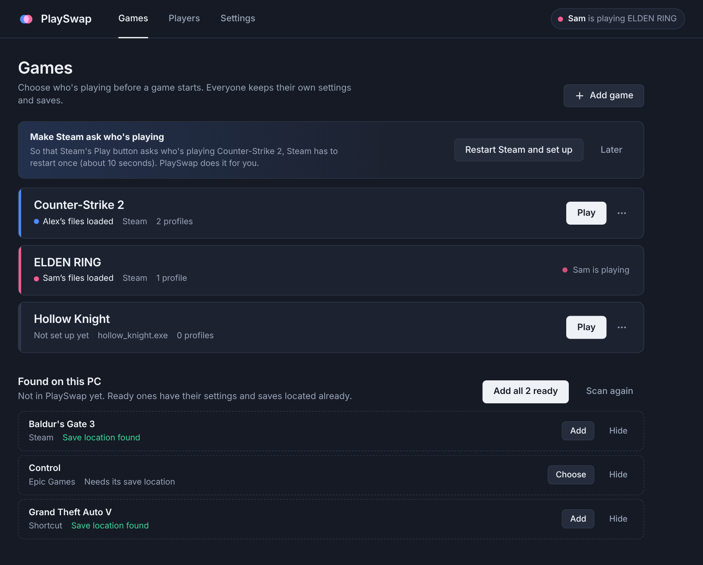
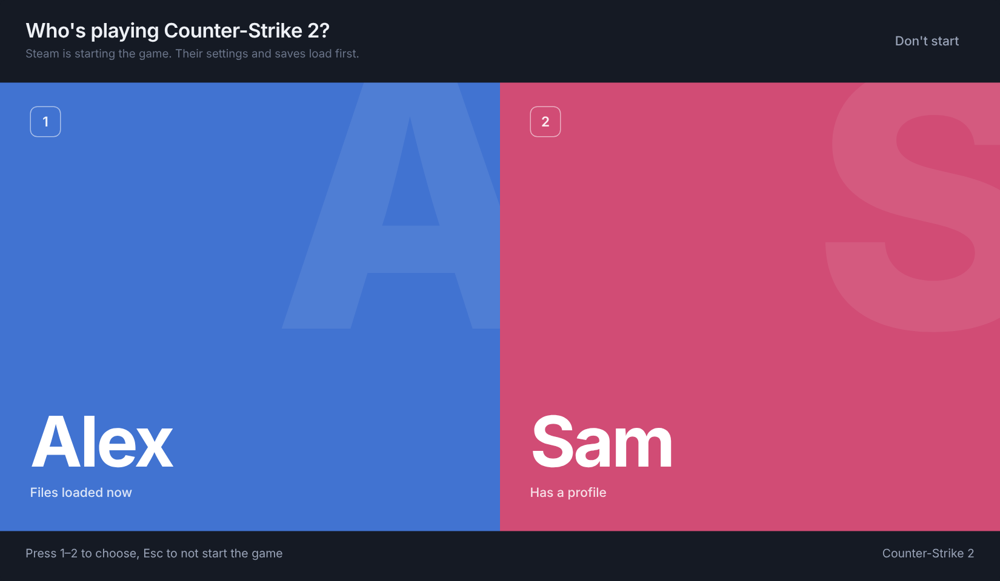

<p align="center"></p>

<h1 align="center">PlaySwap</h1>

<p align="center">Separate game settings and saves for everyone who shares one PC,<br>on one Windows account and one Steam account.</p>

<p align="center"><a href="../../releases/latest"><b>Download for Windows</b></a></p>

---

Press **Play**, pick who's playing, and PlaySwap puts that person's resolution, sensitivity, keybinds and save files in place before the game starts. When the game closes, it saves their progress back to their own profile.

It's made for couples, siblings and housemates who share a gaming PC and keep overwriting each other's settings.



## Features

- **Works with any game** that keeps its settings and saves in files: Steam, Epic, GOG, or a standalone .exe.
- **Finds your games**: scans Steam, Epic, GOG, game folders on every drive, and desktop and Start menu shortcuts. It also locates their save folders for you.
- **Asks from Steam too**: Steam's own Play button opens the "Who's playing?" picker, after a one-time automatic setup.
- **Safe by design**: a backup before every swap, no half-written files, and refuses folders too broad to swap.
- **Lives in the tray**: notices games started outside PlaySwap and saves their progress to whoever's files are loaded.
- **No account, no telemetry, works offline.**



## Install

1. Download `PlaySwap-Setup.exe` from the [latest release](../../releases/latest) and run it.
2. If SmartScreen says it protected your PC, choose **More info**, then **Run anyway**. The app isn't code-signed yet.
3. Name the players, add the games PlaySwap found, and let it set up Steam.

You need Windows 10 or 11 (64-bit) with the Microsoft Edge WebView2 Runtime, which is built into Windows 11 and current Windows 10. No administrator rights are needed. To uninstall, use **Settings > Apps > Installed apps**.

**Turn off Steam Cloud** for each Steam game you manage (game **Properties > General**). Otherwise Steam can sync one person's files over another's.

## What it can't separate

PlaySwap swaps files on your PC. Anything that belongs to the Steam account stays shared: achievements, playtime, friends, inventory, and online ranks. So do settings a game keeps in the Windows registry or on its own servers. If each person can have their own Steam account, that separates everything; PlaySwap is for when you share one.

## How it works

1. You start a game from Steam, from PlaySwap, or from a PlaySwap desktop shortcut.
2. PlaySwap asks who's playing.
3. It saves the files currently on the PC back to whoever they belong to, backs them up, and copies in the chosen player's files.
4. The game starts. PlaySwap watches its process.
5. When the game closes, PlaySwap saves the files to that player's profile.

For Steam, PlaySwap sets each managed game's launch options to `"…\PlaySwap.exe" --steam <app id> -- %command%`. It edits Steam's `localconfig.vdf` only while Steam is closed, changes only `LaunchOptions`, and keeps a backup. Any options you already had are kept, and they're put back when you remove the game or uninstall PlaySwap.

Data lives in `%LOCALAPPDATA%\PlaySwap`: `profiles\<player>\<game>`, `backups\<game>\<date-time>`, `config.json` and `playswap.log`.

## Adding a game by hand

If the scan misses a game, use **Add game**. Choose the Steam game or the .exe, then add every folder or file that holds its settings or saves. [PCGamingWiki](https://www.pcgamingwiki.com) lists these locations for most PC games ("Game data" section). Paths can use `%APPDATA%`, `%LOCALAPPDATA%`, `{LOCALLOW}`, `{DOCUMENTS}`, `{SAVEDGAMES}`, `{STEAM}` and `{STEAMUSER}`.

## Building from source

You need Go 1.24+, Python 3 and bash (Git Bash on Windows). Pillow is optional; it only redraws the icon.

```bash
./build.sh                 # dist/PlaySwap-Setup.exe and dist/PlaySwap.exe
VERSION=1.3.0 ./build.sh   # stamps a version (default: the VERSION file)
go test ./internal/core/   # tests
```

It cross-compiles from Windows, macOS or Linux with no C compiler. Pushing a `v*` tag makes GitHub Actions build both .exe files and publish a release.

| Folder | Contents |
| --- | --- |
| `internal/core` | Swap engine, path safety, Steam and game scanning (platform-neutral, tested) |
| `internal/win` | Windows calls: tray, file dialogs, shortcuts, registry |
| `internal/app` | The app; its interface is in `internal/app/ui` |
| `cmd/playswap`, `cmd/setup` | The app and installer entry points |
| `tools` | Icon, Windows resources (icon, manifest, version), exe checks |
| `third_party` | Vendored, lightly patched go-webview2, go-winloader and golang.org/x/sys |

## Contributing

Bug reports and pull requests are welcome; see [CONTRIBUTING.md](CONTRIBUTING.md). The most useful small contribution is a **game preset**: a game's process name and settings and save locations, added to `KnownSteamGames` in `internal/core/steam.go`.

## License

[MIT](LICENSE). Third-party licenses are in [assets/THIRD_PARTY_NOTICES.txt](assets/THIRD_PARTY_NOTICES.txt).
